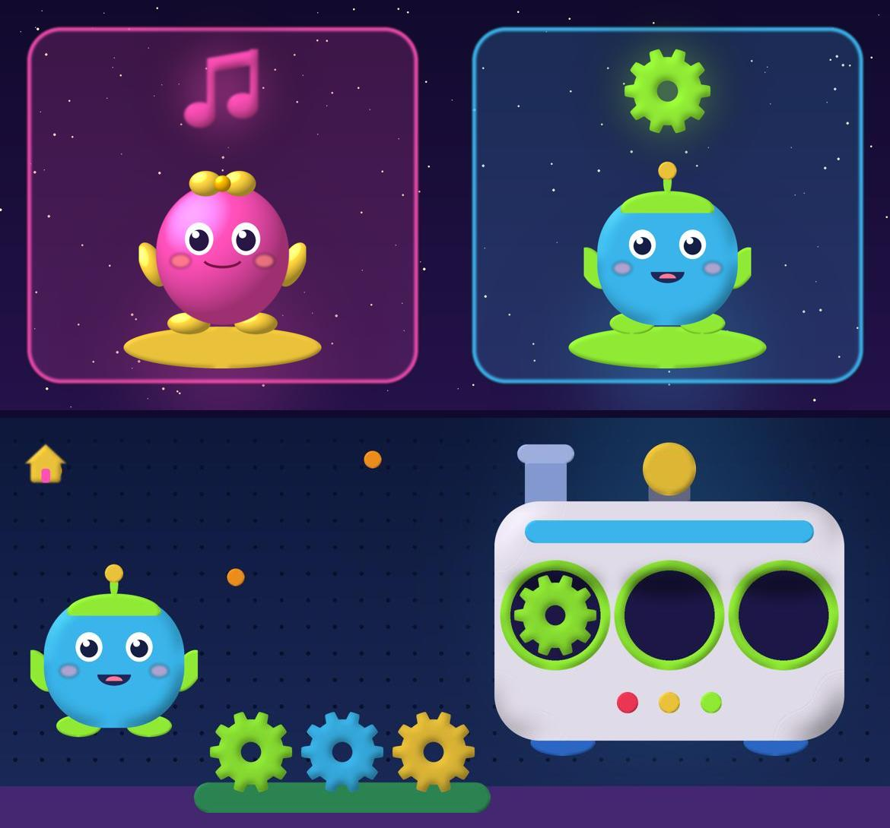

# Aventuras Mágicas con Mimí y Bobi

Videojuego educativo y de exploración para niños de **2 a 3 años** (Android / iOS), hecho con **Godot 4**.
Estética de juguete de arcilla con colores fluorescentes. **Cero frustración**: sin temporizadores, sin castigos y sin "Game Over".



## Probar el juego en el móvil
| Forma | Cómo |
|---|---|
| **Navegador** | Abre la página de GitHub Pages del repositorio: `https://<tu-usuario>.github.io/<repositorio>/` |
| **APK** | Pestaña **Releases** → *Versión de prueba* → descarga `MimiYBobi.apk` e instálalo |
| **Editor Godot (Android)** | Clona o descarga el repositorio → Godot → **Importar** → `project.godot` → ▶ |

Ambas versiones se generan solas con GitHub Actions (`.github/workflows/exportar.yml`) cada vez que se sube un cambio a `main`.

### Activar GitHub Pages (una sola vez)
**Settings → Pages → Build and deployment → Source: GitHub Actions**.

## Contenido actual
| Escena | Descripción |
|---|---|
| `escenas/menu_principal.tscn` | Menú con dos botones de media pantalla: Mimí (ritmo) y Bobi (lógica) |
| `escenas/jardin_nivel1.tscn` | **Nivel 1 · El Jardín de las Sorpresas Musicales**: tres zonas gigantes con notas pentatónicas y partículas |
| `escenas/taller_nivel2.tscn` | **Nivel 2 · El Taller de Bobi**: arrastrar engranajes a una máquina con imanes táctiles |

## Estructura
```
escenas/   Escenas (.tscn)
scripts/   GDScript (un sistema por archivo, documentado)
arte/      Imágenes provisionales (PNG)
audio/     Sonidos (una campanita en Do; las demás notas se generan cambiando el tono)
docs/      Documento de diseño y vista previa
```

## Sistemas reutilizables
| Script | Qué hace |
|---|---|
| `zona_toque_gigante.gd` | Hitbox gigante (Control) que se coloca sola; multitáctil y con anti-palmadas |
| `vigilante_inactividad.gd` | Tras 4 s sin toques, invita a jugar en 3 niveles suaves |
| `retroalimentacion.gd` | Notas pentatónicas + estrellas y corazones al instante |
| `personaje_principal.gd` | Rebote de plastilina y llamadas de atención (Tween o AnimationPlayer) |
| `gestor_arrastre.gd` · `pieza_arrastrable.gd` · `zona_iman.gd` | Arrastrar y soltar con imán, encaje automático y regreso suave |
| `boton_casa.gd` · `transicion.gd` | Volver al menú manteniendo pulsado 1,2 s · fundidos entre escenas |

Más detalles en [`docs/DISENO.md`](docs/DISENO.md).

## Derechos
Proyecto original, de autoría propia. © 2026 — Todos los derechos reservados.
